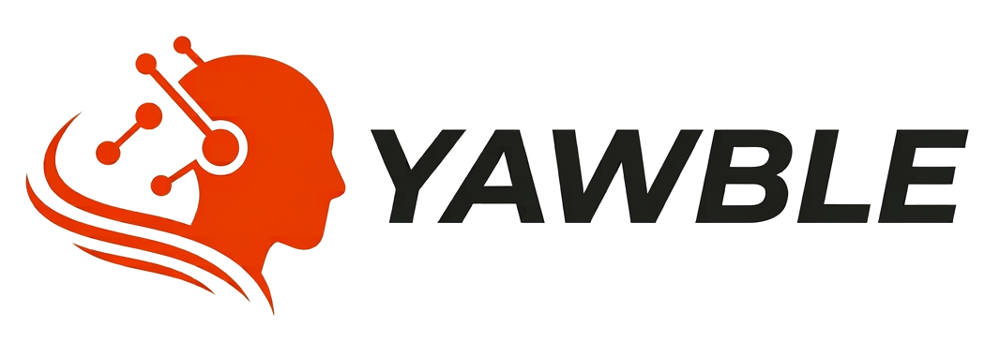

<p align="center">
  <picture>
    <source media="(prefers-color-scheme: dark)" srcset="web/public/logo-dark.png">
    
  </picture>
</p>

<p align="center"><strong>Yawble — A fleet of agents, moving with you.</strong></p>

Yawble runs teams of AI agents on your own machine - Claude, Codex, Copilot and Grok, on the
subscriptions you already pay for or with an API key - with a Concierge to talk to and a board to
watch, steer and review the work. It runs in Podman or Docker on Windows, macOS and Linux.

**[yawble.ai](https://yawble.ai)** has what it does, the [Marketplace](https://yawble.ai/marketplace)
of packages and plugins, and the full setup: **[Get started](https://yawble.ai/get-started)**.

[YouTube](https://www.youtube.com/@Yawble) · [X](https://x.com/_Yawble)

## Install

Install Podman or Docker first ([prerequisites](https://yawble.ai/get-started)), then the `yawble`
CLI, then start it.

Windows, in PowerShell:

```powershell
& ([scriptblock]::Create((irm https://raw.githubusercontent.com/djlsystems/Yawble/main/cli/scripts/install.ps1)))
```

macOS or Linux, in a terminal, as your own user:

```sh
curl -fsSL https://raw.githubusercontent.com/djlsystems/Yawble/main/cli/scripts/install.sh | sh
```

Open a new terminal so `yawble` is on your path, then run `yawble up`. It opens the board at
<http://localhost:8080>, where the first account you create is the owner. `yawble update` updates
the CLI and the instance; `yawble doctor` checks the setup. Every command: [cli/README.md](cli/README.md).

## Documentation

[docs/README.md](docs/README.md) lists every document in this repository; how the pieces fit
together is [docs/architecture.md](docs/architecture.md).

## Build from source

Requirements: .NET 10 SDK, Node 22 with npm, Go, and Podman or Docker for the image.

| What | Command |
|---|---|
| .NET build and tests | `dotnet build tests/Harness.Tests/Harness.Tests.csproj` then `dotnet tests/Harness.Tests/bin/Debug/net10.0/Harness.Tests.dll` |
| .NET tests on Linux in a container (from any OS) | `scripts/test-in-container.sh` |
| Web app | `cd web && npm ci && npm test` (`npm run dev` for a dev server, `npm run build` for production) |
| Operator CLI | `cd cli && go build ./cmd/yawble && go test ./...` |
| Local image and instance (Windows) | `scripts\dev-up.ps1` |

## Contributing

Contributions are welcome. Every contributor signs the [Contributor License Agreement](CLA.md); the
CLA Assistant check asks for it on your first pull request. How to build, test and open a pull
request: [CONTRIBUTING.md](CONTRIBUTING.md).

## License

**Free to use, self-host and modify, including at work. The only thing you can't do is sell Yawble
as a hosted service. Every version becomes Apache 2.0 after two years.**

Yawble is source-available under the Functional Source License, Version 1.1, Apache-2.0 future
license (SPDX: FSL-1.1-ALv2); full terms in [LICENSE](LICENSE). The packages in the Marketplace
([djlsystems/Yawble-packages](https://github.com/djlsystems/Yawble-packages)) are open source under
the Apache License 2.0.

Yawble and the Yawble logo are trademarks of DJL Systems, Inc. Copyright (c) 2026 DJL Systems, Inc.
