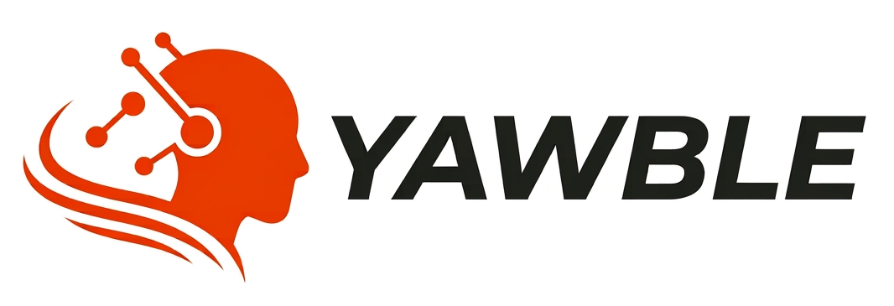

<p align="center">
  <a href="https://yawble.ai">
    <picture>
      <source media="(prefers-color-scheme: dark)" srcset="docs/images/logo-dark.png">
      
    </picture>
  </a>
</p>

<p align="center"><b>AI teamwork. Built-in guardrails. Your control.</b></p>

<p align="center">
  <a href="https://yawble.ai">yawble.ai</a> ·
  <a href="https://yawble.ai/download">Download</a> ·
  <a href="https://yawble.ai/get-started">Get started</a> ·
  <a href="https://www.youtube.com/@Yawble">YouTube</a> ·
  <a href="https://x.com/_Yawble">X</a>
</p>

# Yawble

Yawble is a desktop app that runs teams of AI coding agents on your own computer. You describe the work; a Manager
agent splits it between member agents, each member works on its own branch of your repository, and you review and
merge the result. Every agent run happens inside its own sandbox, with no access to your model credentials, your other
files or the open network.

Yawble is agent-agnostic. Each member of a team picks its own agent CLI and model, so different agents work side by
side in one team: Claude Code, Codex, Grok, GitHub Copilot and Antigravity, as you already installed them. Yawble does
not ship, pin or update them; it finds the ones you installed and runs them from where they are.

- **Teams.** A Manager and members, each with its own CLI, model and instructions. Teams share one global run limit.
- **Your repository.** Each team works in a team repository; every member has its own clone and branch. Branches
  reach the team branch and your remote only through steps you approve.
- **Concierge.** A chat that sees the whole app: it answers questions, recommends, and makes changes when you ask.
- **Board, backlog and documents.** Track the work, dispatch backlog items to a team, and share documents with it.
- **Integrations.** Give agents your own CLIs, MCP servers, APIs and website logins as tools, under approval rules.
- **Guardrails.** A per-member policy (files, network hosts, timeouts) and a guardrail check that tests the sandbox
  from the inside.

## Requirements

- **Windows 11** 24H2 or later, with the August 2026 update or later. Apple silicon **macOS 15** and **Linux** with
  bubblewrap 0.5+ and slirp4netns build and run from source.
- At least one agent CLI, installed and signed in the vendor's way.
- `git` 2.38 or later. Yawble runs your own git and does not ship one. When git is missing or too old the window
  says so; on Windows its **Install Git** button installs Git for Windows for you only, through winget, with no
  administrator prompt.
- A repository host is optional. A team works on a folder on your computer (git needs no account), or on a clone of
  any git repository: GitHub, GitLab, Bitbucket, Azure DevOps or your own server. Branches are pushed with your own
  git sign-in. Pull requests are opened and merged from the app only for repositories on GitHub, with your `gh`.

## Install

Signed installers are published on this repository's
[Releases](https://github.com/djlsystems/Yawble/releases) page: `Yawble-Setup-<version>-x64.exe` and
`Yawble-Setup-<version>-arm64.exe`, a per-user install that needs no administrator rights. `SHA256SUMS` lists the
checksum of every file.

The app keeps its data in `%LOCALAPPDATA%\Yawble` on Windows, `~/Library/Application Support/Yawble` on macOS and
`~/.local/share/yawble` on Linux.

## Documentation

- [Architecture](docs/architecture.md): the processes, the sandbox, the gateway, storage and the security model.
- [Features](docs/features.md): a technical reference of what each part of the app does.
- [Connections and integrations](docs/connections-and-integrations.md): tools for agents and how their secrets are
  kept.
- [Cloud Link](docs/cloud-link.md): viewing the app from a browser.

## Build from source

Prerequisites:

- .NET SDK 10.0.100 or later (`global.json` rolls forward to the latest feature band).
- Node.js 22.12 or later. `npm ci` downloads Electron.
- For the native AOT helper programs: the platform C toolchain (Visual Studio C++ build tools on Windows, the Xcode
  command-line tools on macOS, clang or gcc on Linux).
- Linux without a display: `xvfb-run` for the window tests.

```bash
dotnet build Yawble.slnx
cd shell && npm ci && npm run build
```

Windows also needs the sandbox's `wxc-exec.exe`, which is not in the NuGet package. This fetches it from the pinned
sandbox release and checks its hash (it is never committed):

```bash
node toolchain/fetch-wxc-exec.mjs --platform win-x64
```

### Installers

```bash
cd packaging && npm ci && cd ..
node packaging/build.mjs [--rid win-x64|win-arm64|osx-arm64|linux-x64|linux-arm64]
```

Each OS builds on its own machine. The script stages the payload in `packaging/stage/<rid>/` (`core/`: the
self-contained `yawble-core`; `bin/`: the helper programs and the `yawble` companion; `roles/`) and writes the
installer to `artifacts/installers/<rid>/`: an NSIS setup on Windows, a `.dmg` and `.zip` on macOS, a `.tar.gz` with
`install.sh` on Linux.

On Windows, `--sign` signs every `.exe` and `.dll` that ships, and the installer, through Azure Artifact Signing
(`packaging/signing.json` names the account and certificate profile), and writes `Yawble-Setup-<version>-<arch>.exe`
and `SHA256SUMS`. Files their maker signed (the .NET runtime, the sandbox) keep that signature, and the build fails if
any file ends unsigned. It needs the Windows SDK's `signtool`, the Artifact Signing client tools
(`Azure.CodeSigning.Dlib.dll`; `YAWBLE_SIGNING_DLIB` names it when it is not where they install it), an `az login`, and
the Certificate Profile Signer role on the account.

### Run in development

The shell finds the core in this order: `YAWBLE_CORE_PATH` (a `.dll` runs under `dotnet`), `resources/core` in a
packaged app, then the Debug build in this repository. The helper programs come from the install folder:
`resources/` in a packaged app, or `YAWBLE_INSTALL_DIR`. `YAWBLE_DATA_DIR` opens a different data folder.

On Windows, copy a staged `packaging/stage/<rid>/` to `.devinstall/resources/` once, then:

```bat
scripts\run-dev.cmd
```

Elsewhere:

```bash
YAWBLE_INSTALL_DIR=$PWD/packaging/stage/<rid> npm --prefix shell start
```

## Test

```bash
scripts/test-all.sh
```

That builds, runs every .NET test project, the sandbox release gate (`core/tools/Yawble.SandboxCheck`), the release
script tests, and in `shell/` the typecheck, build, unit tests (vitest) and window tests (Playwright + Electron).
On Linux without a display the window tests run under `xvfb-run`; where Chromium's own sandbox cannot start
(containers, Ubuntu 24.04's AppArmor default) set `YAWBLE_E2E_NO_SANDBOX=1`. That switch exists only in the test
harness.

Pieces on their own:

```bash
dotnet test --project core/tests/Yawble.Core.Tests
dotnet test --project bridge/tests/Yawble.Bridge.Tests
cd shell && npm test && npm run test:e2e
```

Tests that start real sandboxes skip themselves on a host whose sandbox backend is missing. Agent runs in tests use
stand-in CLIs and fake model servers. The tests that check the CLIs installed on the machine (trait
`Category=HostCli`) assert only the CLIs that `YAWBLE_HOSTCLI_EXPECT` lists, e.g. `claude:npm grok:native`.

## The yawble companion

`yawble` (installed with the app in `resources/bin/`) lets another program on the same computer, such as Claude Code,
see and work with your teams through the running app: as an MCP server (`yawble mcp`) or as a CLI (`yawble status`,
`yawble tell <team> <instruction>`, `yawble help`). It talks only to the app on this computer, over a per-launch named
pipe (Windows) or unix socket, and nothing of it is reachable over the Cloud Link.

1. **Pair** once per program, with the app running:

   ```bash
   "<install>\resources\bin\yawble.exe" pair --name claude-code --level act
   ```

   The terminal and the Yawble window show the same 6-character code; approve in the window only when they match.

2. **Add it to Claude Code.** Settings > Companion shows the exact command with a Copy button:

   ```bash
   claude mcp add --scope user yawble -- "<install>\resources\bin\yawble.exe" mcp
   ```

Levels are cumulative: `read` (status, activity, documents, backlog, board, git state), `act` (also tell a team,
answer its questions, edit the backlog and board), `destructive` (also push, merge, delete, restore and other
changes). A destructive call never runs when the program makes it: the window shows the exact plan, and Approve runs
exactly that once. Settings > Companion lists paired programs and revokes them. Every call is audited with the
program's name.

Exit codes: 0 ok, 1 failed, 2 usage, 3 the app is not running, 4 not paired, 5 refused, 6 waiting for your approval,
130 interrupted.

## License

[FSL-1.1-ALv2](LICENSE) (Functional Source License, Version 1.1, with Apache 2.0 as the future license).
Copyright DJL Systems, Inc.
